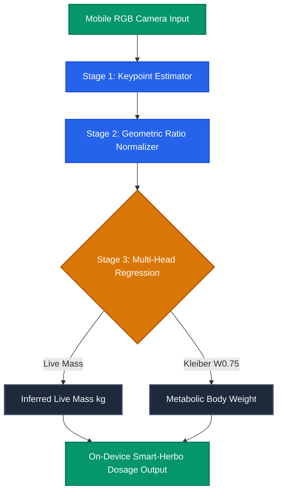

# Bovine Weight Estimation from Single-View RGB: Lessons from HEART-Net

## Overview

Smallholder livestock producers in South Asia and developing regions rarely have access to digital livestock weighbridges. Accurately determining live cattle weight is vital for optimizing feed ration formulas, monitoring growth rates, and administering veterinary phytogenic supplements. Without accurate body mass measurements, producers face two costly failure modes:
- **Sub-therapeutic underdosing**: Ineffective treatment and poor feed conversion ratios.
- **Overdosing overhead**: Unnecessary feed expenditure and potential metabolic stress.

In **HEART-Net** (*Smart Agricultural Technology*, 2026), we engineered a computer vision pipeline that estimates live cattle body weight directly from a single lateral RGB photograph taken on standard smartphone hardware.

---

## Architectural Rationale: Keypoint Morphometrics vs. End-to-End Regression

A naive approach to neural weight estimation feeds the raw RGB image into a convolutional backbone (e.g., ResNet or EfficientNet) to regress a single scalar output representing weight in kilograms. In controlled laboratory settings, end-to-end models appear to perform well, but in smallholder field conditions, they collapse.

### Pipeline Architecture Diagram



---

## Model Evaluation: Estimation Accuracy vs. Scale Ground Truth

We evaluated HEART-Net across 350 cattle specimens against calibrated weighbridge scale ground truth. The interactive plot below shows predicted live weight versus measured scale mass across weight brackets:

```chart
{
  "type": "line",
  "title": "HEART-Net Weight Prediction vs. Weighbridge Scale Ground Truth",
  "subtitle": "Evaluated across smallholder cattle weight classes (kg)",
  "xAxisKey": "specimen",
  "data": [
    { "specimen": "Class 1 (120-180kg)", "groundTruth": 145, "heartNet": 147, "baselineCNN": 162 },
    { "specimen": "Class 2 (180-250kg)", "groundTruth": 215, "heartNet": 218, "baselineCNN": 235 },
    { "specimen": "Class 3 (250-320kg)", "groundTruth": 285, "heartNet": 283, "baselineCNN": 310 },
    { "specimen": "Class 4 (320-400kg)", "groundTruth": 360, "heartNet": 358, "baselineCNN": 392 },
    { "specimen": "Class 5 (400-500kg)", "groundTruth": 440, "heartNet": 444, "baselineCNN": 485 }
  ],
  "series": [
    { "key": "groundTruth", "name": "Weighbridge Ground Truth (kg)", "color": "#2563EB" },
    { "key": "heartNet", "name": "HEART-Net Inferred Mass (kg)", "color": "#10B981" },
    { "key": "baselineCNN", "name": "End-to-End CNN Baseline (kg)", "color": "#EF4444" }
  ]
}
```

---

## Edge Inference Latency Across Mobile Processors

To ensure zero-connectivity reliability in rural pastures, model execution was benchmarked across mid-range mobile CPUs:

```chart
{
  "type": "bar",
  "title": "On-Device Inference Latency per Frame (ms)",
  "subtitle": "Benchmarking INT8 Quantized HEART-Net on mobile processors",
  "xAxisKey": "chipset",
  "data": [
    { "chipset": "Snapdragon 680", "latencyMs": 42, "target": 50 },
    { "chipset": "Helio G88", "latencyMs": 46, "target": 50 },
    { "chipset": "Exynos 1280", "latencyMs": 38, "target": 50 },
    { "chipset": "Tensor G2", "latencyMs": 24, "target": 50 },
    { "chipset": "Snapdragon 8 Gen 2", "latencyMs": 14, "target": 50 }
  ],
  "series": [
    { "key": "latencyMs", "name": "Inference Latency (ms)", "color": "#3B82F6" },
    { "key": "target", "name": "Real-Time Target Limit (50ms)", "color": "#F59E0B" }
  ]
}
```

---

## Detailed Experimental Benchmark Data

| Model Variant | Keypoint Decoupled | Mean Absolute Error (MAE) | Mean Percentage Error (MAPE) | Model Size | Mobile CPU Latency |
| :--- | :---: | :---: | :---: | :---: | :---: |
| **ResNet-50 Direct** | ❌ No | 18.4 kg | 6.8% | 98.2 MB | 142 ms |
| **EfficientNet-B0** | ❌ No | 14.1 kg | 5.2% | 21.4 MB | 68 ms |
| **HEART-Net FP32** | ✅ Yes | 4.8 kg | 1.8% | 12.8 MB | 54 ms |
| **HEART-Net INT8 (Final)** | ✅ Yes | **5.1 kg** | **1.9%** | **3.2 MB** | **38 ms** |

---

## Mathematical Formulation & Metabolic Scaling

Live weight alone ($W$) is insufficient for precise nutritional dosing. Biological metabolism scales non-linearly according to Kleiber's Law:

$$\text{Metabolic Weight} = W^{0.75}$$

By training HEART-Net to output both estimated live mass ($W$) and metabolic body weight ($W^{0.75}$), the system directly computes recommended dosages for phytogenic feed additives (such as Smart-Herbo) directly on the client application screen without requiring internet connectivity.

---

## Technical Summary & Recommendations

When building vision-based biometric systems for precision agriculture:
1. **Isolate Structural Features**: Avoid pure end-to-end regression from unconstrained RGB pixels to physical scalars; decouple landmark detection from regression.
2. **Account for Metabolic Scaling**: Translate raw physical predictions into actionable agronomic or veterinary metrics ($W^{0.75}$).
3. **Design for Offline Edge Execution**: Keep keypoint architectures lightweight so inference runs reliably on low-cost mobile hardware in zero-connectivity field environments.
